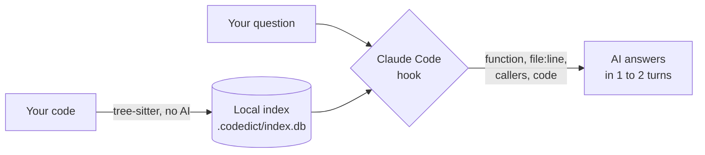

<p align="center">
  
</p>

<p align="center">
  <a href="LICENSE"></a>
  
  
  <a href="BENCHMARK.md"></a>
</p>

<p align="center">
  <b>A dictionary of your code for the AI, and a manual for you.</b><br>
  It reads your project once, with no AI, and hands the answer over together with the question.<br>
  Fewer turns, fewer tokens, the same correct answer.
</p>

<p align="center"><a href="#install">Install</a> · <a href="#why-it-exists">Why</a> · <a href="#how-it-works">How it works</a> · <a href="#benchmark">Benchmark</a> · <a href="INTEGRATION.md">Other AIs</a></p>

---

## Install

One line, once per machine. It also turns codedict on in Claude Code for every project.

**Windows** (PowerShell):

```powershell
irm https://raw.githubusercontent.com/Marqueos/codedict/main/install.ps1 | iex
```

**macOS / Linux:**

```bash
curl -fsSL https://raw.githubusercontent.com/Marqueos/codedict/main/install.sh | sh
```

That's it. Open Claude Code in any git repository and ask about the code. There is nothing else to configure.

<details>
<summary>What the installer does, how to update and how to uninstall</summary>

- Checks for Python 3.11+. If it is missing, it tells you where to get it.
- Creates its own folder in `~/.codedict`. No admin rights, and it does not touch PATH or the system Python.
- Runs `codedict setup`, which writes three hooks to `~/.claude/settings.json` and a short instruction to `~/.claude/CLAUDE.md`. Your settings stay intact, and the previous file is kept as `settings.json.codedict-bak`.

**Update:** run the same line again.

**Uninstall:** run `~/.codedict/venv/bin/python -m codedict setup --remove` (Windows: `~\.codedict\venv\Scripts\python.exe -m codedict setup --remove`) and delete the `~/.codedict` folder.

**Manual install:**

```bash
pip install git+https://github.com/Marqueos/codedict
python -m codedict setup
```

</details>

## Why it exists

codedict came from a practical problem: on a real project with ~250 files in TypeScript, C# and Python, Claude Code sessions kept hitting the usage limit.

We measured it, and the culprit was not the code being read but the **number of turns**. Every time the AI calls a tool (a grep, opening a file), Claude Code re-reads the whole context: 35 to 50 thousand tokens per turn. A simple question like "where is X and who calls it?" took 5 turns of grep and file reads. A flow question like "from the click to the result" took more than 20.

The idea was to do the search work **once, with no AI**, in a local index, and hand the ready answer over together with the question. The AI answers in 1 or 2 turns instead of 5 to 20.

The goal was to cut at least 55% of the tokens without losing a single answer. The measured result was **−63%, with 12 out of 12 correct answers**.

## Results

<p align="center">
  
</p>

| Measure (12 real sessions per side) | Without codedict | With codedict | Difference |
|---|---|---|---|
| Tokens | 4,543,176 | 1,666,033 | **−63%** |
| Turns | 138 | 34 | −75% |
| Cost | US$ 5.76 | US$ 4.27 | −26% |
| Correct answers | 12/12 | 12/12 | = |

Cost falls less than tokens because the fixed part of each session (the context cache) is the most expensive part, and it does not go away. Full method, every round and what went wrong along the way: [BENCHMARK.md](BENCHMARK.md).

## How it works



1. **Reads the code once.** Finds every function, class, HTTP route and SQL table, and who calls whom. Stores it all in a local SQLite file, spending zero tokens.
2. **Keeps itself up to date.** When the project opens and after each AI edit, it re-reads only the files that changed.
3. **Answers with the question.** When you ask about the code, the hook searches the index and hands the result to the AI together with your question: the exact location, every call site, the chain up to the entry point, and the code.
4. **Stays quiet otherwise.** Prompts that are not about code ("thanks", "commit this") and `/` commands get nothing.

Without codedict, the AI goes: question, grep, open a file, another grep, another file, and only then answers. That is 5 to 20 turns, and each one re-reads everything.

### What about RAG?

codedict does the same step as a RAG: it fetches context and hands it to the AI before the answer. The difference is how it searches.

| | Typical RAG | codedict |
|---|---|---|
| How it searches | By "similar" text (embeddings) | By exact names and the code's real links |
| Needs AI to build | Yes, an embedding model | No, it just parses the code |
| What it returns | Chunks that look like the question | The function, the line, its callers and the chain up to the entry point |
| Complete? | It can miss the chunk that matters | Lists every call site |
| Updates | Recomputes vectors | Re-reads only the changed file, for free |

Because it is only a retrieval step, it works with any AI: Claude, GPT, Gemini or a local model.

## Two dictionaries from one index

| For | Where | What it has |
|---|---|---|
| **The AI** | `.codedict/ai/`, `codedict search` and the MCP server | A compact map of the project and ready answers per question |
| **You** | `.codedict/docs/README.md` | A Markdown manual with Mermaid diagrams: modules, routes, tables and who calls whom |

The `.codedict/` folder ships with its own `.gitignore`, so it never clutters your repository.

## Other AIs

| Tool | How to connect |
|---|---|
| Claude Code | Automatic, through the installer |
| Cursor, Codex, Gemini CLI, OpenCode, Windsurf | MCP server (`codedict --root <project> mcp`) plus `codedict agent-snippet >> AGENTS.md` |
| Any model, including local ones (Ollama, LiteLLM) | RAG mode: `codedict search "<question>" --budget 2000`, then paste the output into the prompt |

Step by step, with Python examples: [INTEGRATION.md](INTEGRATION.md). Day-to-day use: [GUIDE.md](GUIDE.md).

## Commands

```bash
codedict search "where is the discount calculated"  # start here: a ready answer
codedict show Pricing.applyDiscount                 # card + exact lines (accepts several names)
codedict callers OrderService.Save                  # who calls it
codedict callees OrdersController.Get               # what it calls
codedict overview                                   # big picture: modules, entry points, key symbols
codedict map src/Billing/                           # files and symbols of a module
codedict routes api/orders                          # HTTP routes
codedict tables Orders                              # SQL tables and who uses them
codedict note Pricing.applyDiscount "Rule approved by finance"  # a note that survives reindexing
codedict index .                                    # index by hand (Claude Code does it for you)
```

## Benchmark

The test compared real Claude Code sessions with and without codedict. Everything needed to reproduce it is in `bench/`, and the full report is in [BENCHMARK.md](BENCHMARK.md).

**How we measured:**
1. Two identical copies of the same private project. Only copy B has the index and the codedict instruction.
2. Neither copy has Claude memory or any file with the answers.
3. Same prompt, same model and same allowed tools (read-only) on both sides.
4. 3 sessions per task on each side, reporting the median. The same task varied up to 45% between sessions.
5. An answer counts as correct when it names the expected functions and files. This check is automatic.

**Results:**

| Round | Token savings | Correct answers |
|---|---|---|
| Default install, with hook (4 tasks × 3 sessions) | median 63% per task, −63% total | 12/12 |
| Flow questions, instruction only (2 × 3) | median 57.8%, −52% total | 6/6 |
| Short searches, instruction only (10 × 3) | median 51.5%, −51% total | 30/30 |

**Zero-token check on public projects:** a script runs the questions straight against the index, with no AI, and reports whether the first search already returns the full answer. Anyone can reproduce it:

| Project | Language | Result |
|---|---|---|
| [psf/requests](https://github.com/psf/requests) | Python | 3 of 4 questions answered in one search |
| [spf13/cobra](https://github.com/spf13/cobra) | Go | 3 of 3 |

```bash
git clone https://github.com/spf13/cobra && git -C cobra checkout adbc881
codedict index cobra
python bench/answerability.py cobra bench/public/cobra.json        # no tokens, ~1 second
python bench/ab_test.py --a <copy-without> --b <copy-with> --tasks bench/tasks.example.json --reps 3   # real sessions (spends tokens)
```

**Honest limits:**
- Each Claude Code session has a fixed cost of ~37 thousand tokens per turn. codedict cuts turns, not that floor.
- Cost in dollars falls less than tokens (−26% vs −63%), because writing the context to the cache is the most expensive kind of token.
- Vague questions ("is the app any good?") have no name to search for. In that case codedict sends nothing and the AI works as usual.

## Languages

Python, JavaScript, TypeScript/TSX, C#, Java and Go (tree-sitter), SQL/T-SQL and Razor/Blazor (regex). Other files (`.json`, `.csproj`, `.md`…) are listed as files.

Questions can be in English or Portuguese: the search understands inflections in both ("parsed" finds `ParseFlags`, "exclusão" finds `excluir`).

For another language, copy a `.toml` from `codedict/languages/` to the project's `.codedict/languages/` and adjust the grammar nodes. Grammars come from `tree-sitter-language-pack`, which has more than 160 languages.

<details>
<summary>The algorithm, step by step</summary>

1. **Walk:** `git ls-files` (respects `.gitignore`) plus `.codedictignore`. Skips generated and minified files and secrets (`.env`, `*.pem`).
2. **Hash:** sha256 per file; only changed files are reprocessed.
3. **Extraction:** tree-sitter with one `.toml` per language (grammar node → universal kind). SQL and Razor by regex.
4. **Per-symbol record:** kind, qualified name, lines, signature, doc comment, decorators and parent.
5. **Extra facts:** HTTP routes (.NET, Minimal API, FastAPI/Flask, Spring, Nest, Express, Razor `@page`), SQL tables in strings and `.sql` files, `EXEC` calls.
6. **Call resolution without a compiler**, with `high/medium/low` confidence: same file, declared variable type, inheritance, `partial class`, methods outside the type (Go), imports and same directory.
7. **Cross-language bridges:** `npm run`, `python -m`, `go run` and `dotnet run` link, for example, a C# app to the TypeScript script it runs.
8. **Ranking:** PageRank on the call graph × usage in other files.
9. **Search:** SQLite FTS5 over identifier words (`calculateTax` → `calculate tax`), path and docs, accent-insensitive, with inflections.

**"What it does", without AI:** manual note (`codedict note`) → doc comment → signature and name. Without a doc comment, the description is structural (where it is, what it calls, who calls it), not semantic.

**Known limits:** resolution is by name and declared type, not by a compiler; conventional MVC routes are inferred as `/{Controller}/{Action}`; Razor and XAML give file-level facts only.

</details>

## License

[MIT](LICENSE)
