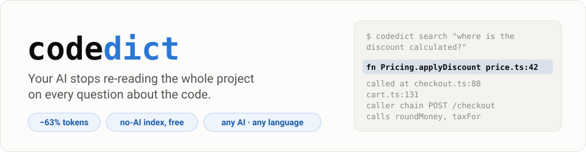
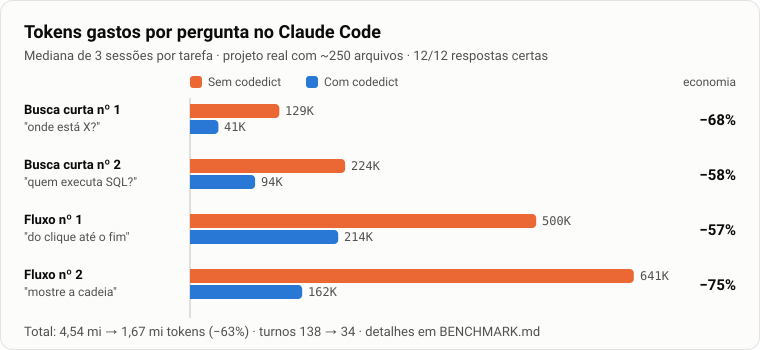
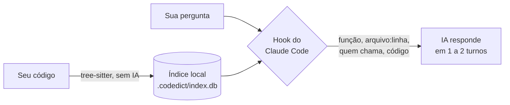

<p align="center">
  
</p>

<p align="center">
  <a href="LICENSE"></a>
  
  
  <a href="BENCHMARK.md"></a>
</p>

<p align="center">
  <b>Um dicionário do seu código para a IA, e um manual para você.</b><br>
  Lê o projeto uma vez, sem IA, e entrega a resposta pronta junto com a pergunta.<br>
  Menos turnos, menos tokens, a mesma resposta certa.
</p>

<p align="center"><a href="#instalação">Instalação</a> · <a href="#de-onde-surgiu">Por quê</a> · <a href="#como-funciona">Como funciona</a> · <a href="#benchmark">Benchmark</a> · <a href="INTEGRACAO.md">Outras IAs</a> · <a href="#english">English</a></p>

---

## Instalação

Uma linha, uma vez por máquina. Já liga no Claude Code para todos os projetos.

**Windows** (PowerShell):

```powershell
irm https://raw.githubusercontent.com/Marqueos/codedict/main/install.ps1 | iex
```

**macOS / Linux:**

```bash
curl -fsSL https://raw.githubusercontent.com/Marqueos/codedict/main/install.sh | sh
```

Pronto. Abra o Claude Code em qualquer repositório git e pergunte sobre o código. Não há mais nada para configurar.

<details>
<summary>O que o instalador faz, como atualizar e como remover</summary>

- Confere o Python 3.11+. Se faltar, diz onde baixar.
- Cria uma pasta própria em `~/.codedict`. Não precisa de administrador e não mexe no PATH nem no Python do sistema.
- Roda `codedict setup`, que grava três hooks em `~/.claude/settings.json` e uma instrução curta em `~/.claude/CLAUDE.md`. As suas configurações ficam intactas, e o arquivo anterior é guardado como `settings.json.codedict-bak`.

**Atualizar:** rode a mesma linha de novo.

**Remover:** rode `~/.codedict/venv/bin/python -m codedict setup --remove` (Windows: `~\.codedict\venv\Scripts\python.exe -m codedict setup --remove`) e apague a pasta `~/.codedict`.

**Instalação manual:**

```bash
pip install git+https://github.com/Marqueos/codedict
python -m codedict setup
```

</details>

## De onde surgiu

O codedict nasceu de um problema prático: num projeto real, com ~250 arquivos em TypeScript, C# e Python, as sessões do Claude Code viviam estourando o limite de uso.

Medimos e o culpado não era o código lido, e sim o **número de turnos**. Cada vez que a IA chama uma ferramenta (um grep, abrir um arquivo), o Claude Code relê o contexto inteiro: 35 a 50 mil tokens por turno. Uma pergunta simples, como "onde está X e quem chama?", levava 5 turnos de grep e leitura. Uma pergunta de fluxo, como "do clique até o resultado", levava mais de 20.

A ideia foi fazer o trabalho de busca **uma vez, sem IA**, num índice local, e entregar a resposta pronta junto com a pergunta. A IA responde em 1 ou 2 turnos em vez de 5 a 20.

A meta era cortar pelo menos 55% dos tokens sem perder nenhuma resposta. O resultado medido foi **−63%, com 12 de 12 respostas certas**.

## Resultado

<p align="center">
  
</p>

| Medida (12 sessões reais por lado) | Sem codedict | Com codedict | Diferença |
|---|---|---|---|
| Tokens | 4.543.176 | 1.666.033 | **−63%** |
| Turnos | 138 | 34 | −75% |
| Custo | US$ 5,76 | US$ 4,27 | −26% |
| Respostas certas | 12/12 | 12/12 | = |

O custo em dólar cai menos que os tokens porque a parte fixa de cada sessão (o cache do contexto) é a mais cara e não some. Método completo, todas as rodadas e o que deu errado no caminho: [BENCHMARK.md](BENCHMARK.md).

## Como funciona



1. **Lê o código uma vez.** Acha cada função, classe, rota HTTP e tabela SQL, e quem chama quem. Grava tudo num SQLite local, sem gastar nenhum token.
2. **Mantém atualizado sozinho.** Ao abrir o projeto e depois de cada edição da IA, relê só os arquivos que mudaram.
3. **Responde junto com a pergunta.** Quando você pergunta algo sobre o código, o hook busca no índice e entrega o resultado à IA junto com a pergunta: o lugar exato, todos os pontos de chamada, a cadeia até o ponto de entrada e o trecho de código.
4. **Fica quieto no resto.** Conversa que não é sobre código ("valeu", "faz o commit") e comandos `/` não recebem nada.

Sem codedict, a IA faz assim: pergunta, grep, abre arquivo, outro grep, abre outro arquivo e só então responde. São 5 a 20 turnos, e cada um relê tudo.

### E o RAG?

O codedict faz a mesma etapa de um RAG: busca o contexto e entrega à IA antes da resposta. A diferença está em como busca.

| | RAG comum | codedict |
|---|---|---|
| Como busca | Por texto "parecido" (embeddings) | Por nome exato e pelas ligações reais do código |
| Precisa de IA para montar | Sim, um modelo de embedding | Não, só lê o código |
| O que devolve | Trechos parecidos com a pergunta | A função, a linha, quem chama e a cadeia até a entrada |
| Completo? | Pode faltar o trecho que importa | Lista todos os pontos de chamada |
| Atualizar | Recalcula os vetores | Relê só o arquivo alterado, de graça |

Por ser só uma etapa de busca, funciona com qualquer IA: Claude, GPT, Gemini ou um modelo local.

## Dois dicionários do mesmo índice

| Para quem | Onde | O que tem |
|---|---|---|
| **A IA** | `.codedict/ai/`, `codedict search` e o servidor MCP | Mapa compacto do projeto e respostas prontas por pergunta |
| **Você** | `.codedict/docs/README.md` | Manual em Markdown com diagramas Mermaid: módulos, rotas, tabelas e quem chama quem |

A pasta `.codedict/` já vem com o próprio `.gitignore`, então não suja o seu repositório.

## Outras IAs

| Ferramenta | Como ligar |
|---|---|
| Claude Code | Automático pelo instalador |
| Cursor, Codex, Gemini CLI, OpenCode, Windsurf | Servidor MCP (`codedict --root <projeto> mcp`) e `codedict agent-snippet >> AGENTS.md` |
| Qualquer modelo, inclusive local (Ollama, LiteLLM) | Modo RAG: `codedict search "<pergunta>" --budget 2000` e cole o resultado no prompt |

Passo a passo com exemplos em Python: [INTEGRACAO.md](INTEGRACAO.md). Uso no dia a dia: [GUIA.md](GUIA.md).

## Comandos

```bash
codedict search "onde o desconto é calculado"  # comece por aqui: resposta pronta
codedict show Pricing.applyDiscount            # ficha + linhas exatas (aceita vários nomes)
codedict callers OrderService.Save             # quem chama
codedict callees OrdersController.Get          # o que chama
codedict overview                              # visão geral: módulos, entradas, símbolos-chave
codedict map src/Billing/                      # arquivos e símbolos de um módulo
codedict routes api/orders                     # rotas HTTP
codedict tables Orders                         # tabelas SQL e quem usa
codedict note Pricing.applyDiscount "Regra validada com o financeiro"  # nota que sobrevive à reindexação
codedict index .                               # indexa à mão (o Claude Code já faz sozinho)
```

## Benchmark

O teste comparou sessões reais do Claude Code com e sem codedict. Tudo para reproduzir está em `bench/`, e o relatório completo em [BENCHMARK.md](BENCHMARK.md).

**Como medimos:**
1. Duas cópias idênticas do mesmo projeto privado. Só a cópia B tem o índice e a instrução do codedict.
2. Nenhuma das cópias tem memória do Claude nem arquivos com as respostas.
3. Mesmo prompt, mesmo modelo e mesmas ferramentas liberadas (só leitura) nos dois lados.
4. 3 sessões por tarefa em cada lado, reportando a mediana. A mesma tarefa chegou a variar 45% entre sessões.
5. Uma resposta conta como certa quando cita as funções e os arquivos esperados. Essa conferência é automática.

**Resultados:**

| Rodada | Economia de tokens | Respostas certas |
|---|---|---|
| Instalação padrão, com hook (4 tarefas × 3 sessões) | mediana de 63% por tarefa, −63% no total | 12/12 |
| Perguntas de fluxo, só com a instrução (2 × 3) | mediana de 57,8%, −52% no total | 6/6 |
| Buscas curtas, só com a instrução (10 × 3) | mediana de 51,5%, −51% no total | 30/30 |

**Checagem sem tokens, em projetos públicos:** um script roda as perguntas direto no índice, sem IA, e diz se a primeira busca já traz a resposta completa. Qualquer pessoa reproduz:

| Projeto | Linguagem | Resultado |
|---|---|---|
| [psf/requests](https://github.com/psf/requests) | Python | 3 de 4 perguntas respondidas numa busca só |
| [spf13/cobra](https://github.com/spf13/cobra) | Go | 3 de 3 |

```bash
git clone https://github.com/spf13/cobra && git -C cobra checkout adbc881
codedict index cobra
python bench/answerability.py cobra bench/public/cobra.json        # sem tokens, ~1 segundo
python bench/ab_test.py --a <cópia-sem> --b <cópia-com> --tasks bench/tasks.example.json --reps 3   # sessões reais (gasta tokens)
```

**Limites honestos:**
- Cada sessão do Claude Code tem um custo fixo de ~37 mil tokens por turno. O codedict corta turnos, mas não esse piso.
- O custo em dólar cai menos que os tokens (−26% contra −63%), porque gravar o contexto em cache é o tipo de token mais caro.
- Perguntas vagas ("o app está bom?") não têm nome para buscar. Nesse caso o codedict não manda nada e a IA trabalha como sempre.

## Linguagens

Python, JavaScript, TypeScript/TSX, C#, Java e Go (tree-sitter), SQL/T-SQL e Razor/Blazor (regex). Outros arquivos (`.json`, `.csproj`, `.md`…) entram como arquivos listados.

Para outra linguagem, copie um `.toml` de `codedict/languages/` para `.codedict/languages/` do projeto e ajuste os nós da gramática. A gramática vem do `tree-sitter-language-pack`, que tem mais de 160 linguagens.

<details>
<summary>O algoritmo, passo a passo</summary>

1. **Varredura:** `git ls-files` (respeita o `.gitignore`) mais `.codedictignore`. Ignora arquivos gerados, minificados e segredos (`.env`, `*.pem`).
2. **Hash:** sha256 por arquivo; só reprocessa o que mudou.
3. **Extração:** tree-sitter com um `.toml` por linguagem (nó da gramática → tipo universal). SQL e Razor por regex.
4. **Registro por símbolo:** tipo, nome qualificado, linhas, assinatura, comentário de documentação, decorators e pai.
5. **Fatos extras:** rotas HTTP (.NET, Minimal API, FastAPI/Flask, Spring, Nest, Express, Razor `@page`), tabelas SQL em strings e `.sql`, chamadas `EXEC`.
6. **Resolução de chamadas sem compilador**, com confiança `high/medium/low`: mesmo arquivo, tipo declarado da variável, herança, `partial class`, métodos fora do tipo (Go), imports e mesmo diretório.
7. **Pontes entre linguagens:** `npm run`, `python -m`, `go run` e `dotnet run` ligam, por exemplo, um app C# ao script TypeScript que ele roda.
8. **Ranking:** PageRank no grafo de chamadas × uso em outros arquivos.
9. **Busca:** SQLite FTS5 sobre as palavras dos identificadores (`CalcularImposto` → `calcular imposto`), caminho e documentação, sem acento. Também entende inflexões: "parsed" acha `ParseFlags` e "exclusão" acha `excluir`.

**"O que faz", sem IA:** nota manual (`codedict note`) → comentário de documentação → assinatura e nome. Sem comentário, a descrição é estrutural (onde está, o que chama, quem chama), não semântica.

**Limites conhecidos:** a resolução é por nome e tipo declarado, não por compilador; rotas MVC por convenção são inferidas como `/{Controller}/{Action}`; Razor e XAML dão só fatos de arquivo.

</details>

---

## English

**codedict** is a deterministic code dictionary for AI agents and developers. It parses your repo once with tree-sitter (no AI, zero tokens), stores symbols, call sites and routes in a local SQLite index, and hands the AI the exact answer (file:line, every caller, the call chain and the code) together with the question.

**Why:** in Claude Code every tool call re-reads the whole context (35-50K tokens per turn). Questions like "where is X and who calls it?" took 5 to 20 turns of grep and file reads. With codedict they take 1 or 2.

**Result** (real Claude Code sessions, 4 tasks × 3 runs per side): **−63% tokens**, −75% turns, −26% cost, 12/12 correct answers. See [BENCHMARK.md](BENCHMARK.md).

**Install** (also turns it on in Claude Code for every project):

```bash
curl -fsSL https://raw.githubusercontent.com/Marqueos/codedict/main/install.sh | sh                   # macOS / Linux
irm https://raw.githubusercontent.com/Marqueos/codedict/main/install.ps1 | iex                       # Windows PowerShell
```

**Other agents:** MCP server (`codedict --root <project> mcp`) plus `codedict agent-snippet >> AGENTS.md`. **Any LLM, including local models:** `codedict search "<question>" --budget 2000` is the retrieval step of a RAG, exact instead of similar. See [INTEGRACAO.md](INTEGRACAO.md).

**Two outputs from one index:** a compact map for the AI (`.codedict/ai/`) and Markdown + Mermaid docs for humans (`.codedict/docs/`).

## Licença

[MIT](LICENSE)
